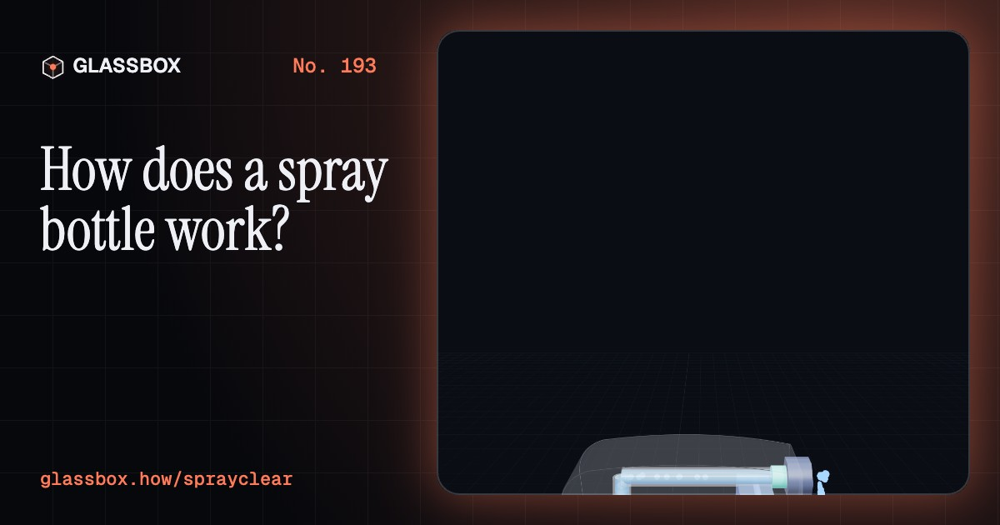
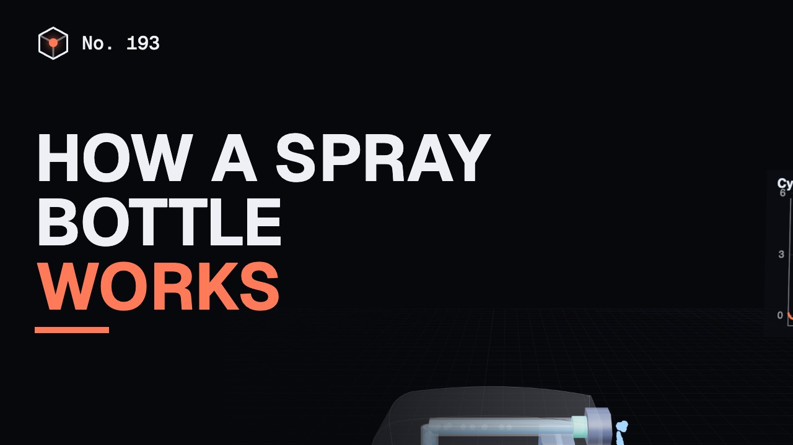
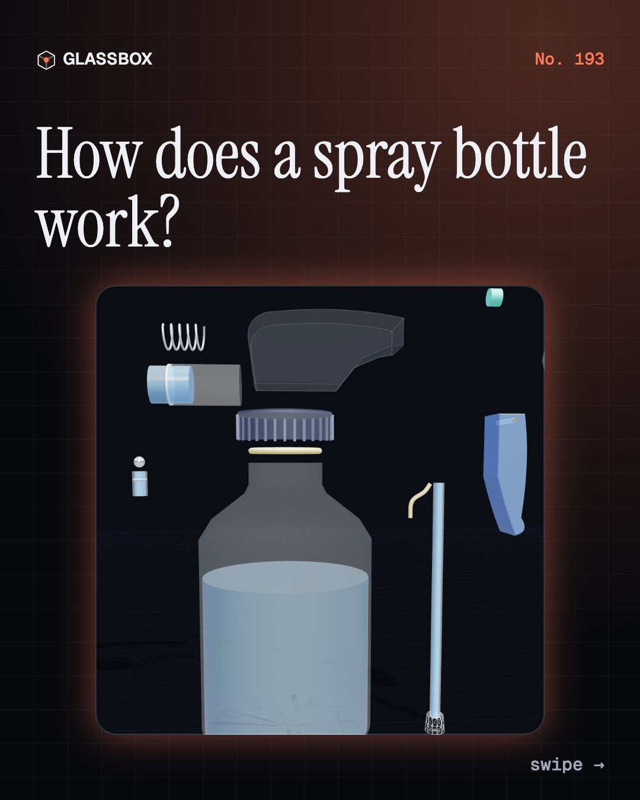
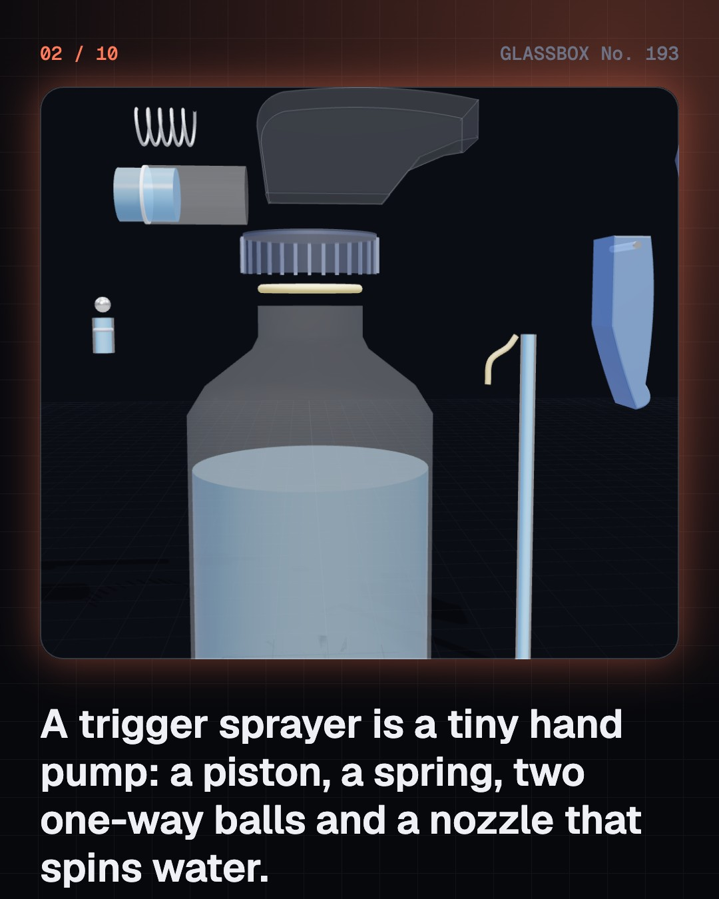
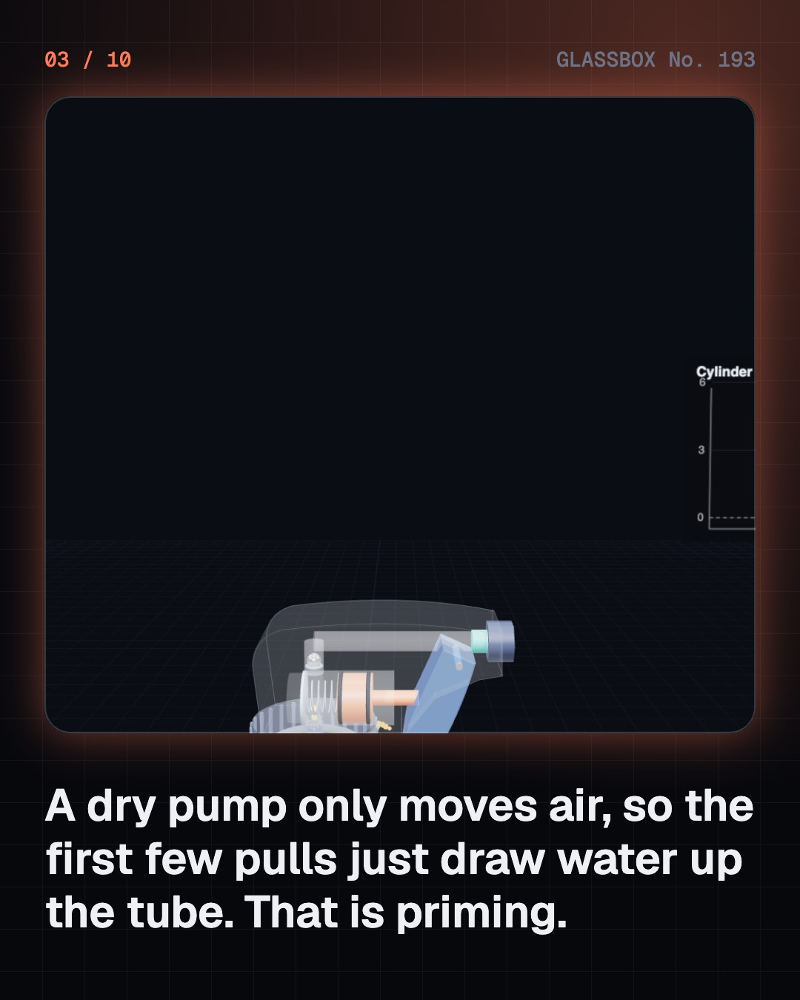
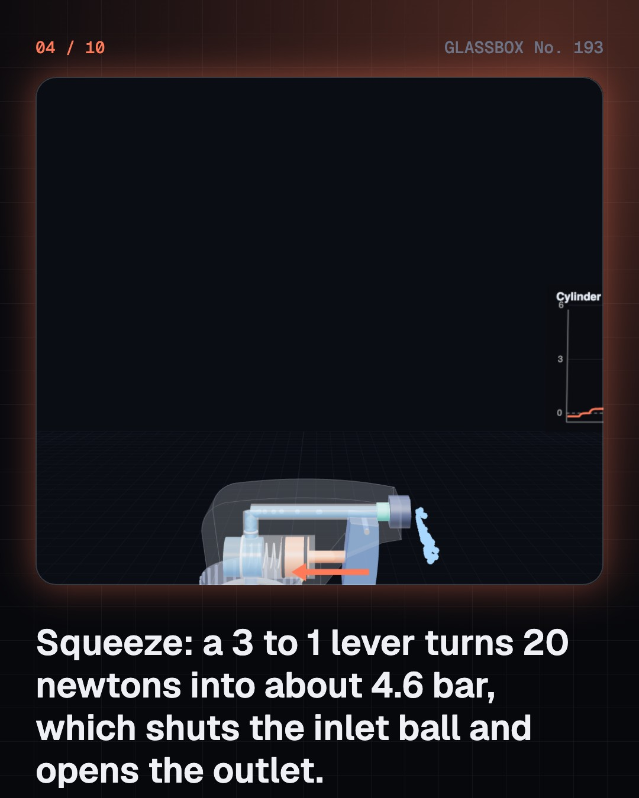

<!-- glassbox:start -->
<!-- Generated from glassbox.json by the Glassbox hub (npm run readme -- sprayclear). Edit glassbox.json, not this block. -->
<p align="center"><a href="https://glassbox.how/e/sprayclear/"></a></p>

<h1 align="center">SprayClear</h1>

<p align="center"><b>How does a spray bottle work?</b><br>One squeeze of your finger makes about 4.6 bar, shuts one tiny ball, opens another and tears a millilitre of water into drops thinner than a hair. Pull the trigger of a spray bottle in slow motion and watch it happen.</p>

<p align="center"><a href="https://glassbox.how/sprayclear/"><b>▶ Play with it</b></a> &nbsp;·&nbsp; <a href="https://glassbox.how/e/sprayclear/">Read the 60-second explainer</a> &nbsp;·&nbsp; <a href="https://glassbox.how/sprayclear/glassbox/reel.mp4">Watch the 40-second video</a></p>

<p align="center">
  <a href="https://glassbox.how/e/sprayclear/"></a>
  <a href="https://glassbox.how/e/sprayclear/"></a>
  <a href="LICENSE"></a>
  <a href="LICENSE-CONTENT.md"></a>
  <a href="#privacy"></a>
</p>

## In 60 seconds

1. **A tiny hand pump on a bottle.** A trigger sprayer screws onto a bottle and needs no gas or battery. A lever drives a piston in a small cylinder, a spring brings it back, and two ball valves make the flow go one way.
2. **Squeeze, then let go.** Squeezing with 20 N on a 3 to 1 lever makes about 4.6 bar, which shuts the inlet ball and opens the outlet. Letting go lowers the cylinder's pressure, and the air on the bottle's liquid pushes about 1 mL up the tube. A dry pump takes a few pulls to prime.
3. **From a jet to a mist.** Pressure gives up to 30 m/s at the hole. A swirl chamber spins the liquid into a hollow cone. The thin sheet tears into threads, and surface tension pinches them into drops about 60 microns across in our model.
4. **How far and how fine.** Drag brakes small drops within centimetres, and they can evaporate in seconds, while 1 mm drops from the stream setting fly over 4 metres. Thick oils and gels are too sluggish to mist.
5. **The cousins.** A perfume bulb and an airbrush really use suction, from fast air. An aerosol can stores its pressure in a propellant. A pump-up knapsack stores it in air you pump by hand.
6. **Use it safely.** A disinfectant needs its label's contact time, wet on the surface. Never mix cleaning products: some combinations give off toxic gas. Label every refill, keep sprays from eyes and children, and follow pesticide labels.

## Words worth knowing

| Term | Meaning |
|---|---|
| **Positive-displacement pump** | A pump that moves a fixed amount of liquid each stroke by squeezing a closed space. |
| **Check valve** | A one-way gate, here a small ball that flow lifts off its seat in one direction and shuts in the other. |
| **Priming** | Replacing the air in a pump and tube with liquid so it can build pressure. |
| **Swirl chamber** | A tiny room behind the nozzle hole where side-entering liquid spins, so it leaves as a hollow cone. |
| **Surface tension** | The pull between molecules at a liquid's surface that makes it act like a stretched skin. |
| **Weber number** | A ratio of how hard moving liquid pushes against how strongly surface tension holds it together. |
| **Rayleigh–Plateau instability** | Why a thread of liquid pinches into beads: spheres have less surface. |
| **Contact time** | How long a disinfectant must stay wet on a surface for the label's claim to hold. |
| **Propellant** | The gas in an aerosol can that stores the pressure and pushes the product out. |

## A short history

**From a doctor's rubber bulb to a finger-powered plastic pump, and the can that changed the sky.**

- **1858** · The pulverisateur (Jean Sales-Girons, France)
- **1888** · The DeVilbiss atomiser (Dr Allen DeVilbiss, Toledo, Ohio, USA)
- **1926** · Rotheim's aerosol can (Erik Rotheim, Oslo, Norway)
- **1941** · The bug bomb (Lyle Goodhue and William Sullivan, Beltsville, Maryland, USA)
- **1949** · The crimp-on valve (Robert Abplanalp, New York, USA)
- **1965** · Plastic trigger sprayers reach shops (Various makers, USA and Japan)
- **1974** · CFCs and the ozone warning (Mario Molina and F. Sherwood Rowland, University of California, Irvine, USA)
- **1987** · The Montreal Protocol (Governments, under UNEP, Montreal, Canada)

The full story, with 26 moments, charts, people and 39 sources: [glassbox.how/e/sprayclear/history](https://glassbox.how/e/sprayclear/history/). The data lives in [`history.json`](history.json).

## Video and slides

Made with the Glassbox studio from this box's storyboard (`window.glassbox.director`). Free to reuse under CC BY 4.0.

<a href="https://glassbox.how/sprayclear/glassbox/video.mp4"></a>

<p><a href="glassbox/slide-1.jpg"></a> <a href="glassbox/slide-2.jpg"></a> <a href="glassbox/slide-3.jpg"></a> <a href="glassbox/slide-4.jpg"></a></p>

| File | What | Size |
|---|---|---|
| [`glassbox/reel.mp4`](https://glassbox.how/sprayclear/glassbox/reel.mp4) | Reel / Short, with captions and soundtrack | 1080×1920 |
| [`glassbox/video.mp4`](https://glassbox.how/sprayclear/glassbox/video.mp4) | YouTube video, with captions and soundtrack | 1920×1080 |
| `glassbox/slide-1…10.jpg` | Instagram carousel | 1080×1350 |
| `glassbox/thumb.jpg` | YouTube thumbnail | 1280×720 |
| `glassbox/cover.jpg` | Share card and repo social preview | 1200×630 |
| [`glassbox/history-reel.mp4`](https://glassbox.how/sprayclear/glassbox/history-reel.mp4) | “History in 10 moments” Reel / Short | 1080×1920 |
| `glassbox/history-slide-*.jpg` | History carousel | 1080×1350 |
| `glassbox/post.json` | Post copy and schedule used by the publish kit | |

## Privacy

This box has no accounts and no ads, and it ships its own fonts and libraries. When you run it yourself it sends nothing anywhere. On glassbox.how, the site's `/bar.js` also loads Glassbox's analytics: **Google Analytics** to count visits (it asks first in the EU, UK and Switzerland, and stays off when your browser sends Global Privacy Control or Do Not Track) and **ClickTrust** to detect bots.

It remembers a few things **in your own browser only**, and never sends them anywhere:

| Browser storage key | What it holds |
|---|---|
| `sprayclear.v1` | Which chapters you have opened, your best quiz scores, and sound on or off. |

Exactly what each one sees is at [glassbox.how/privacy](https://glassbox.how/privacy/).

## Licences

- **Code:** [MIT](LICENSE). Use it, change it, ship it.
- **Explanations, text, images and videos** (`glassbox.json`, `glassbox/`): [CC BY 4.0](LICENSE-CONTENT.md). Credit “Glassbox, glassbox.how/e/sprayclear”.
- **Third-party parts** keep their own licences: [three.js](https://threejs.org) (MIT), [Geist, Instrument Serif](https://openfontlicense.org) (SIL OFL 1.1).
- The Glassbox name and logo aren't covered by either licence. See the [terms](https://glassbox.how/terms/).

Found a mistake? [Open an issue](https://github.com/bdeeps/sprayclear/issues). Corrections happen in public.
<!-- glassbox:end -->

## Run it

It's plain HTML, CSS and JavaScript. No build step and no dependencies. Run locally, it contacts no other website.

```bash
python3 -m http.server 8000
```

Three.js and the fonts ship in `vendor/` and `fonts/`, so it also works offline.

Then open http://localhost:8000.

## How it's built

| File | What |
|---|---|
| `index.html`, `css/app.css` | The page and its styles |
| `js/app.js`, `js/stage.js`, `js/ui.js`, `js/kit.js` | The shared Glassbox 3D engine: chapters, 3D stage, controls, quiz, video director |
| `js/chapters/*.js` | One file per chapter: the 3D model, controls, text, key terms, quiz and video scenes |
| `js/spray.js` | The pump, nozzle, drop and drying models, the generic cut-away sprayer, and the chart boards |
| `glassbox.json` | Title, question, explainer beats, key terms, browser storage and credits shown on glassbox.how |
| `reel` in each chapter | The storyboard the Glassbox studio records into short videos |
| `glassbox/` | The published video, slides, thumbnail and post copy |
| `fonts/`, `vendor/three/` | Self-hosted Geist and Instrument Serif (SIL OFL 1.1) and three.js (MIT) |
